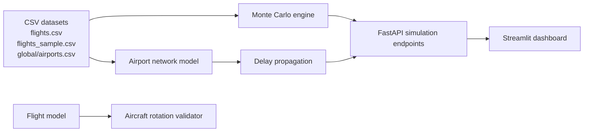

# ✈️ Airline Network Disruption Simulation Engine

An experimental airline disruption and network simulation engine. The Python project explores stochastic delay and cancellation scenarios, airport-network propagation, aircraft rotation integrity checks, and simplified economic estimates. It is an engineering and research prototype, not an operational airline system.

## 🚀 Overview

The project uses local CSV datasets and probabilistic models to explore how disruptions can affect flights and connected airports. It also provides a separate schedule-validation component for checking aircraft assignments and flight rotations against supplied position, time, and turnaround evidence.

## ⚙️ Implemented Capabilities

- **Monte Carlo simulation:** Repeated stochastic simulations using configurable run counts.
- **Delay modeling:** Random delay generation using input dataset parameters.
- **Cancellation modeling:** Probabilistic cancellation sampling.
- **Statistical analysis:** Mean delay and 95th-percentile delay calculations.
- **Airport network modeling and delay propagation:** A directed airport graph with stochastic propagation across connected routes.
- **Aircraft rotation integrity validation:** Structured schedule and aircraft-chain outcomes for assignment, continuity, chronology, position, cancellation, ferry/positioning, and configured turnaround checks.
- **Economic impact estimation:** Simplified estimates based on simulated delay and cancellation values; not a calibrated airline cost model.
- **FastAPI service:** HTTP endpoints for global Monte Carlo and network simulation results.

The aircraft rotation validator operates on `Flight` model instances and is separate from the current Monte Carlo and API simulation flows.

## Aircraft Rotation Validation

`AircraftRotation.validate_rotation()` validates flights grouped by aircraft and returns an overall schedule outcome, per-aircraft-chain outcomes, and structured issues. In strict mode, callers supply an authoritative aircraft catalogue, initial aircraft positions, and turnaround configuration. The validator requires timezone-aware datetimes in the UTC schedule fields and checks their chronology.

The structured outcomes distinguish:

| Outcome | Meaning |
|---|---|
| `VALID` | The structural and applicable feasibility checks passed for the selected validation mode. |
| `INVALID_SCHEDULE` | The schedule contains contradictory or invalid evidence, such as duplicate flight IDs, conflicting authoritative assignments, or invalid chronology. |
| `INFEASIBLE_ROTATION` | The known schedule cannot be flown as provided, such as overlapping assignments, disconnected airport movement, or insufficient configured turnaround. |
| `INCOMPLETE_ROTATION` | Required evidence is missing, such as an aircraft assignment, position, timestamp, aircraft type, or strict turnaround configuration. |

The validator distinguishes a missing assignment from an explicitly unknown authoritative aircraft ID. Cancellation handling uses established aircraft position: a scheduled origin alone does not establish where an aircraft is. A cancelled leg can leave a later flight feasible when the position and availability evidence support it; unknown position or cancellation stage remains incomplete.

Strict ferry and positioning legs are treated as aircraft movements. Their origin must match the established aircraft position, and they require explicit, timezone-aware UTC departure and arrival timestamps. The validator checks movement continuity and configured turnaround; it does not represent a complete airline dispatch feasibility model.

`AircraftRotation.build()` is a legacy grouping method. It preserves legacy grouping and passenger/cargo continuity behavior, but ferry/positioning legs bypass its continuity check. It does not validate strict ferry movement; use `validate_rotation()` for that validation. `propagate_delay()` continues to use the legacy build path.

Local timezone fields on `Flight` are labels only: the validator does not convert them to UTC or handle daylight-saving-time ambiguity. Strict validation rejects naive datetimes in the UTC schedule fields; it does not verify or convert the local timezone labels.

## API Endpoints

| Method | Endpoint | Purpose |
|---|---|---|
| `GET` | `/` | Service status |
| `GET` | `/simulate/global` | Global Monte Carlo simulation |
| `GET` | `/simulate/real` | Uses the same Monte Carlo implementation as the global simulation |
| `POST` | `/simulate/network` | Directed network disruption simulation |

### Network simulation request

```bash
curl -X POST http://127.0.0.1:8000/simulate/network \
  -H "Content-Type: application/json" \
  -d '{"runs":500,"start_airport":"CDG","initial_delay":60,"seed":123}'
```

Request body:

```json
{
  "runs": 500,
  "start_airport": "CDG",
  "initial_delay": 60,
  "seed": 123
}
```

Example response:

```json
{
  "mean_network_delay": 60.0,
  "p95_network_delay": 60.0,
  "max_delay": 60.0,
  "affected_airports": ["CDG", "FRA", "JFK"],
  "runs": 500
}
```

## 🧠 Technology Stack

| Technology | Purpose |
|---|---|
| Python | Core implementation |
| FastAPI | API layer |
| NumPy | Random sampling and numerical calculations |
| Pandas | Input data processing |
| NetworkX | Airline network modeling modules |
| Streamlit | Dashboard prototype |
| Plotly | Optional visualization support |
| Requests | Dashboard API requests |
| PyVis | Interactive visualization support |
| Matplotlib | Static visualization support |
| SimPy | Event simulation support |

## 🏗️ Architecture



The Monte Carlo and airport-network simulation paths expose results through FastAPI. The rotation validator consumes `Flight` objects and produces schedule and aircraft-chain validation results; it is currently a separate component and is not invoked by those API endpoints.

- **API layer:** Exposes simulation functionality through FastAPI.
- **Monte Carlo engine:** Executes repeated stochastic simulations.
- **Network modeling and propagation:** Represents airport connections as a directed graph and simulates delay propagation.
- **Flight model and rotation validation:** Represents flight schedules and checks supplied aircraft-chain evidence.
- **Economic analysis:** Estimates simplified financial impacts.

The current API exposes the global Monte Carlo implementation, the `/simulate/real` alias, and the network POST endpoint. It does not expose a rotation-validation endpoint.

## 📊 Simulation Output

The active simulation endpoint returns metrics including:

- `mean_delay`
- `p95_delay`
- `cancelled_flights`
- `economic_loss_usd`
- `runs`

Results are generated from the project's local CSV dataset and stochastic model. They are experimental estimates, not live operational forecasts.

## ▶️ Getting Started

### 1. Clone the repository

```bash
git clone https://github.com/salehmahamathissene/aviation-risk-simulator.git
cd aviation-risk-simulator
```

### 2. Create a virtual environment

**Windows PowerShell**

```powershell
py -m venv .venv
.venv\Scripts\Activate.ps1
```

**Linux / macOS**

```bash
python -m venv .venv
source .venv/bin/activate
```

### 3. Install dependencies

```bash
python -m pip install --upgrade pip
pip install -r requirements.txt
```

### 4. Run the API

```bash
uvicorn app.main:app --reload
```

Open:

- API: http://127.0.0.1:8000
- Interactive API documentation: http://127.0.0.1:8000/docs

### 5. Execute a simulation

```bash
curl http://127.0.0.1:8000/simulate/global
```

The simulation currently defaults to 2,000 runs.

### 6. Start the dashboard

In a separate terminal:

```bash
streamlit run dashboard.py
```

Open `http://127.0.0.1:8501`.

The dashboard calls the API at `http://127.0.0.1:8000`.

## 🧪 Testing

Install the runtime and development dependencies:

```bash
python -m pip install -r requirements-dev.txt
```

Run the complete test suite:

```bash
python -m pytest -q
```

The same test command runs in GitHub Actions.

## GitHub Actions CI

The workflow at `.github/workflows/tests.yml` runs on pushes to `main`, pull requests targeting `main`, and manual `workflow_dispatch` events. It uses Ubuntu and Python 3.11, installs dependencies from `requirements-dev.txt`, and runs `python -m pytest -q`. Its `GITHUB_TOKEN` permission is explicitly limited to `contents: read`.

## ⚠️ Scope and Limitations

This is an experimental engineering project and is not certified or approved for operational airline dispatch or safety decisions.

- The current input dataset is illustrative and limited in size.
- `data/flights_sample.csv` contains an illustrative `JFK -> LAX` route. `LAX` is not present in `data/global/airports.csv`, so that route is excluded by strict airport validation.
- The `/simulate/real` endpoint currently uses the same simulation implementation as `/simulate/global`; it does not retrieve live airline data.
- The network model uses a small directed route graph and stochastic propagation factors.
- The network simulation is separate from the aircraft rotation validator and does not model airport capacity, weather, crew, maintenance, passenger connections, or live airline operations.
- Rotation validation checks supplied schedule evidence and configured turnaround rules; it does not establish real-world operational feasibility.
- Economic estimates use simplified assumptions rather than validated airline cost models.

Simulation results and validation outcomes should not be used for actual dispatch, safety, financial, or regulatory decisions.

## 🔭 Future Development

Potential areas for further development include:

- Historical flight-data integration.
- Advanced scheduling and fleet-planning constraints beyond the current rotation-integrity checks.
- Integration of rotation validation with simulation workflows.
- Recovery optimization and more detailed recovery strategies.
- Historical-data calibration and validation.
- Interactive network visualization.
- More realistic operational and economic assumptions, subject to suitable data and validation.

## 👨‍💻 Author

**Saleh Mahamat**

Software Engineering Student | Backend & Full-Stack Developer | Aviation Technology

GitHub: [https://github.com/salehmahamathissene](https://github.com/salehmahamathissene)

Project repository: https://github.com/salehmahamathissene/aviation-risk-simulator
